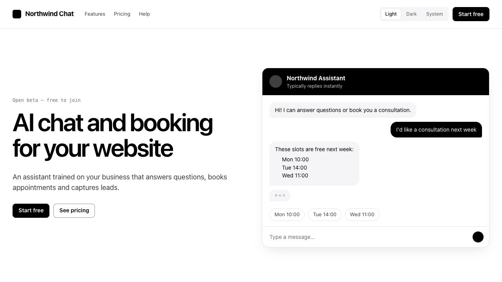
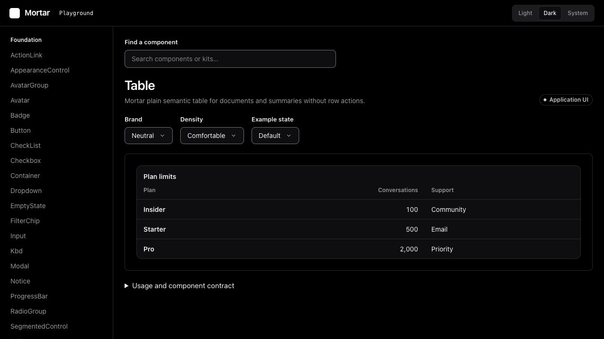
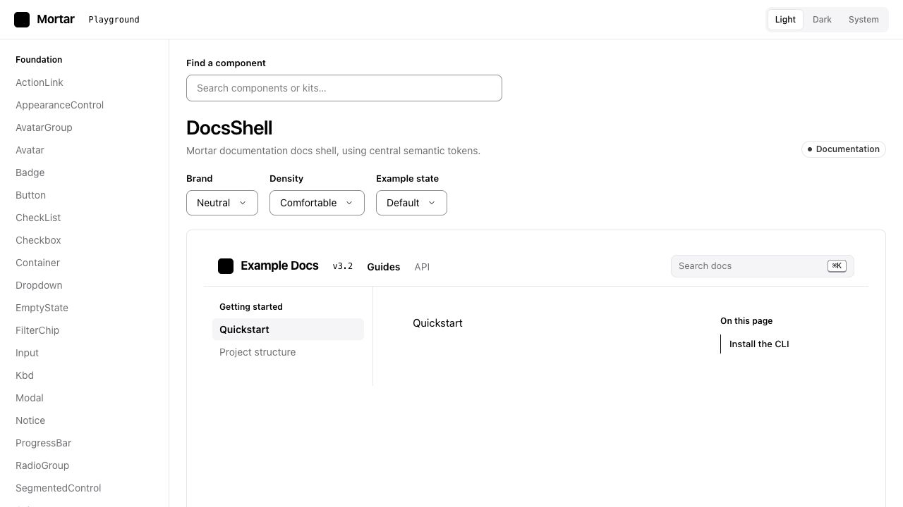

# Mortar

A shared design foundation and purpose-built Application UI, Marketing UI, Docs UI and Ecommerce kits for React 19 and Tailwind CSS 4. MIT licensed. No account, token, registry connection or subscription is required to use the kit, including use by coding agents.

The package is `@tony-ui/mortar`, distributed from owner-hosted infrastructure. Releases are immutable and publicly downloadable without a service account. Publishing is automatic and version-driven: merging a version bump to `main` publishes that version once the required checks pass ([release workflow](.github/workflows/release.yml), [process](CONTRIBUTING.md)). The current version is listed on the [GitHub releases](https://github.com/tonycodes/mortar/releases) page. Source, issues and contributions live at [github.com/tonycodes/mortar](https://github.com/tonycodes/mortar).

[Explore the live playground](https://mortar.tony.codes/playground/) · [Contribute](CONTRIBUTING.md) · [Hosted agent services](#mortar-cloud-and-premium-services)

## See the kit

These screenshots show the kit running in the public playground. All product names,
plans, prices and support labels inside the examples are demonstration content,
not Mortar offers. The playground follows `main`; screenshots may show components
that are not yet in the latest npm release.

**Marketing UI — a composed landing page in light mode.**

[](https://mortar.tony.codes/playground/?recipe=saas-landing&theme=light)

**Application UI — a semantic table in dark mode, inside the shared explorer.**

[](https://mortar.tony.codes/playground/?component=Table&theme=dark)

**Docs UI — navigation, search and an article outline using the shared DocsShell.**

[](https://mortar.tony.codes/playground/?component=DocsShell&theme=light)

Open any screenshot to try its live example. Switch appearance, brand, density and
example states in the playground.

## Install

```sh
npm config set @tony-ui:registry https://git.tony.codes/api/packages/tony/npm/ --location=project
npm install @tony-ui/mortar react react-dom tailwindcss
```

No UI service credential is needed.

## Changes and upgrades

See [CHANGELOG.md](CHANGELOG.md) for every release. [Theming](docs/theming.md) explains brands, appearance, density and the token scales. Upgrading from 0.5 or earlier? [Migrating to 0.6](docs/migrating-to-0.6.md) lists every renamed prop.

## Local install

Pack from this workspace (`npm pack` builds `dist` first):

```sh
npm pack
```

Install the resulting `tony-ui-mortar-<version>.tgz` in the consuming app, with React 19, React DOM 19 and Tailwind 4. Public releases use https://git.tony.codes/api/packages/tony/npm/.

In the app's Tailwind CSS entry:

```css
@import "tailwindcss";
@import "@tony-ui/mortar/styles.css";
```

The package ships its component styles. Standalone use requires no source scanning or hosted account. The separately governed hosted workflow currently also requires `@source '../node_modules/@tony-ui/mortar/src';` in the CSS entry; generated agent starters include that policy declaration.

```tsx
import { ThemeProvider, AppShell, Button } from "@tony-ui/mortar";

<ThemeProvider brand="neutral" density="comfortable" initialAppearance="system">
  <AppShell
    brand="Example"
    navigation={[{ label: "Overview", href: "/", current: true }]}
  >
    <Button onClick={save}>Save changes</Button>
  </AppShell>
</ThemeProvider>;
```

`brand` (`neutral | green`) and `density` (`compact | comfortable | spacious`) are controlled provider props. Appearance (`light | dark | system`) is changed using `AppearanceControl`; system changes are observed. Use one root provider. It restores document attributes on unmount. The provider uses effects: SSR applications should set matching initial document attributes to prevent a first-paint theme flash.

## Purpose kits

The catalogue assigns each export to one purpose. Foundation primitives serve all purpose kits. Application UI provides shells, page headings, metrics, selectable tables, settings and activity. Marketing UI provides headers, heroes, features, social proof, pricing, FAQs, calls to action and footers. Docs UI provides a shared documentation shell, search, code examples, API references and article navigation. Ecommerce provides product lists, product overviews with option pickers, shopping carts and order summaries; prices arrive preformatted so currency and locale stay with the consumer. Product content and callbacks remain in the consumer. Sample names and prices belong only in the catalogue demonstrations.

Controls use native HTML and Headless UI. Tabs support arrow/Home/End navigation; dialogs and menus use Headless UI focus management. Density has a 44px control floor on coarse pointers. Feedback colours remain separate from the brand.

## Mortar Cloud and premium services

The MIT kit is free to use, customise and contribute to, including commercial
projects and agent-assisted development. Mortar Cloud is the separate hosted
agent and governance service for keeping applications on a centrally controlled UI.

| Free MIT kit                                          | Hosted cloud capabilities                                                     |
| ----------------------------------------------------- | ----------------------------------------------------------------------------- |
| Components, purpose kits, themes and shared shells    | Registry discovery of approved components and dependency relationships        |
| Local playground and component contracts              | Agent build packets with reusable components and service workflow defaults    |
| Local baseline, browser and accessibility checks      | Registry-aware application audits against approved implementations            |
| GitHub issues, contributions and maintainer PR review | OAuth MCP connections, individual agent credentials and stored audit evidence |

The cloud service helps agents discover what to reuse and gives application teams
consistent adoption rules and audit feedback. Component source review remains on
GitHub; a cloud subscription is not required to contribute or install the kit.
The kit contains no licence checks, telemetry or calls to the cloud service.

**Current availability:** hosted onboarding is available as a preview. Paid plans,
checkout, subscription activation and premium human-support terms are not yet
launched. There is currently no purchase or premium-support activation step, and
no published support SLA. The preview onboarding below does not purchase a plan.

### Connect an agent to the hosted preview

- **Coding agents:** give your agent [the onboarding guide](https://mortar.tony.codes/agent.md)
  and your application brief. It follows the [service skill](https://mortar.tony.codes/agent-skill.md)
  to register its own identity, discover components and run the hosted audit. No team
  invitation or owner token is required. CLI onboarding needs Node 22 or newer.
- **Remote MCP clients:** add `https://mortar.tony.codes/mcp` as the remote connector URL
  and complete the browser OAuth consent flow. See the
  [connector guide](https://mortar.tony.codes/mcp.md) for supported flows.
- **Kit bugs and contributions:** use [GitHub issues](https://github.com/tonycodes/mortar/issues)
  and [pull requests](CONTRIBUTING.md). This is community maintenance, not a paid
  support entitlement. Do not put credentials or private project details in issues.

Visit [the agent area](https://mortar.tony.codes/#agents) for the hosted entry point.
The private service and its history are not covered by this repository's MIT licence.

## Run the playground locally

```sh
npm ci
npm run dev
```

Open `http://127.0.0.1:4340`. The playground is this repository's standalone Vite
application, built directly from `src`, `previews` and the component catalogue.
It is the local visual development surface for new and updated components.
No marketing-site process, service account or governance backend is required.

In production it has its own build and deployment at
[mortar.tony.codes/playground/](https://mortar.tony.codes/playground/). It shares the domain
and hosting infrastructure with the marketing/cloud site, but deploys independently.
Merges to `main` deploy it after checks pass. Marketing-site changes and immutable
npm releases have separate deployment/publication workflows. See [operations](ops/README.md).

## Client-side routing

Connect your application's router once at the provider. All kit-owned links
(including AppShell, DocsShell, MarketingHeader, breadcrumbs, tables and action
links) use this adapter for ordinary same-origin navigation:

```tsx
<ThemeProvider
  navigate={(href) => {
    router.push(href);
  }}
>
  <App />
</ThemeProvider>
```

For React Router, pass its `useNavigate()` function through a void-returning
callback. The router must render the destination and manage route focus/scroll.
Return `false` for routes your router does not handle. Without an adapter, links
retain native browser navigation. External links, downloads, same-page fragments,
modified clicks and new-tab links remain native. Consumer-authored anchors still
belong to the consumer's router; this does not intercept the whole document.

Theme selection can also be controlled with `appearance` and
`onAppearanceChange`; `initialAppearance` remains the uncontrolled starting value.
Brand and density already update through their provider props. None of these
settings requires reloading the page. Existing apps must install a release
containing this API, wire their router, and rebuild to adopt it.
