# Extended kits preview evidence

Captured by `tests/browser/extended.spec.mjs` in local Chrome. This is review evidence, not component approval.

PlanComparison is constrained by the shared marketing-section sizing. At 390px the page fits the viewport and the comparison table scrolls inside its keyboard-focusable region. The browser suite checks document width at mobile and desktop sizes in both appearances.

## CommandPalette-dark-at-1280px

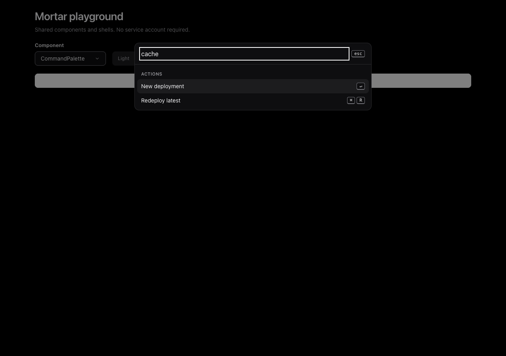

## CommandPalette-dark-at-390px

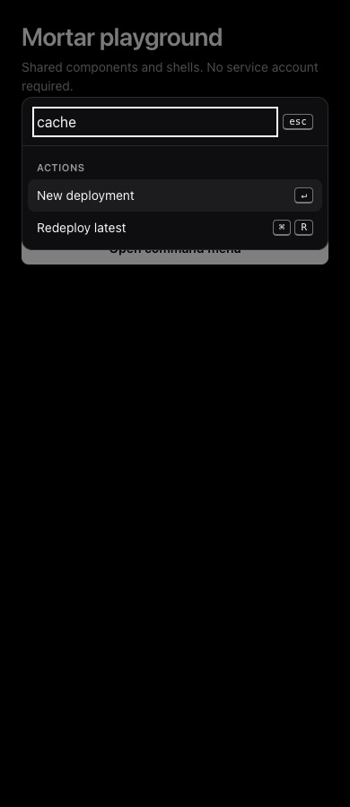

## CommandPalette-light-at-1280px

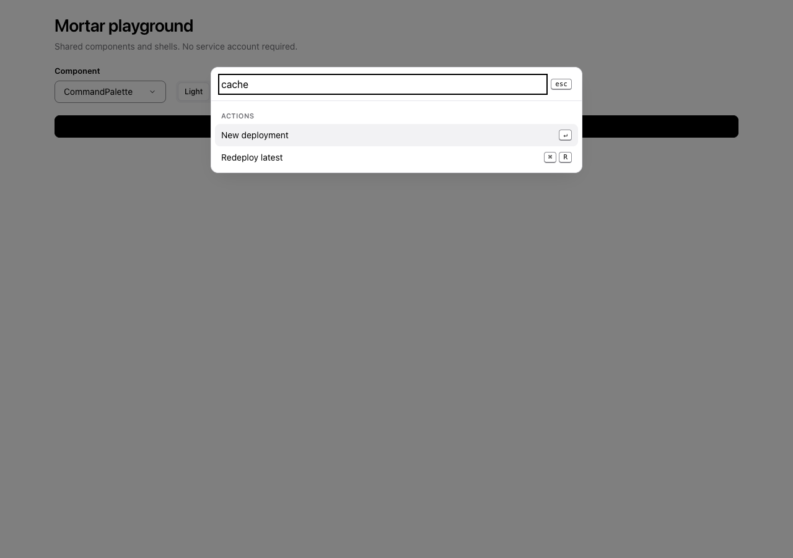

## CommandPalette-light-at-390px

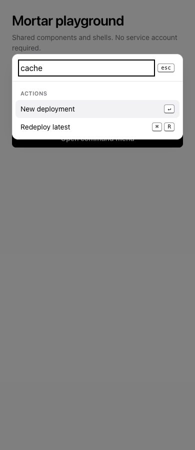

## ConfirmDialog-dark-at-1280px

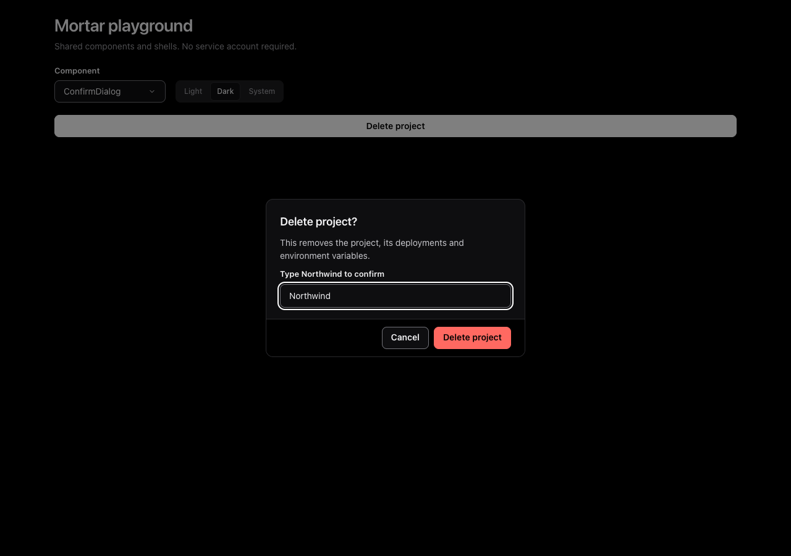

## ConfirmDialog-dark-at-390px

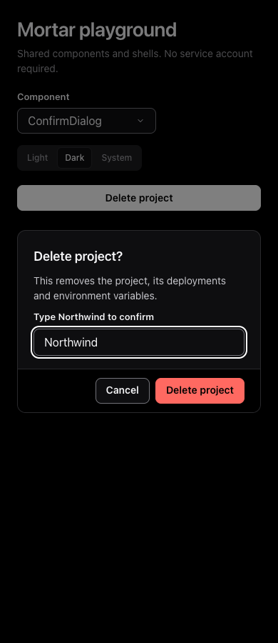

## ConfirmDialog-light-at-1280px

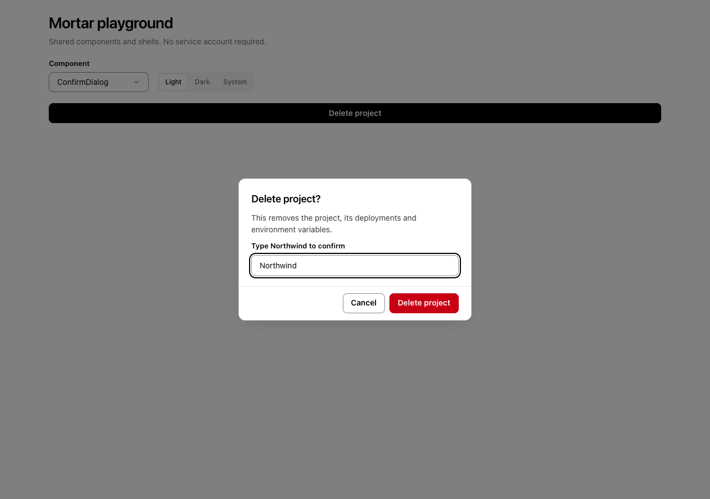

## ConfirmDialog-light-at-390px

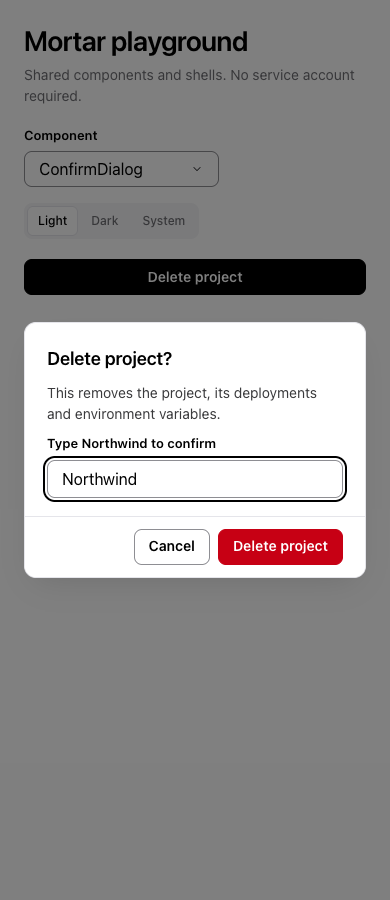

## DocsShell-dark-at-1280px

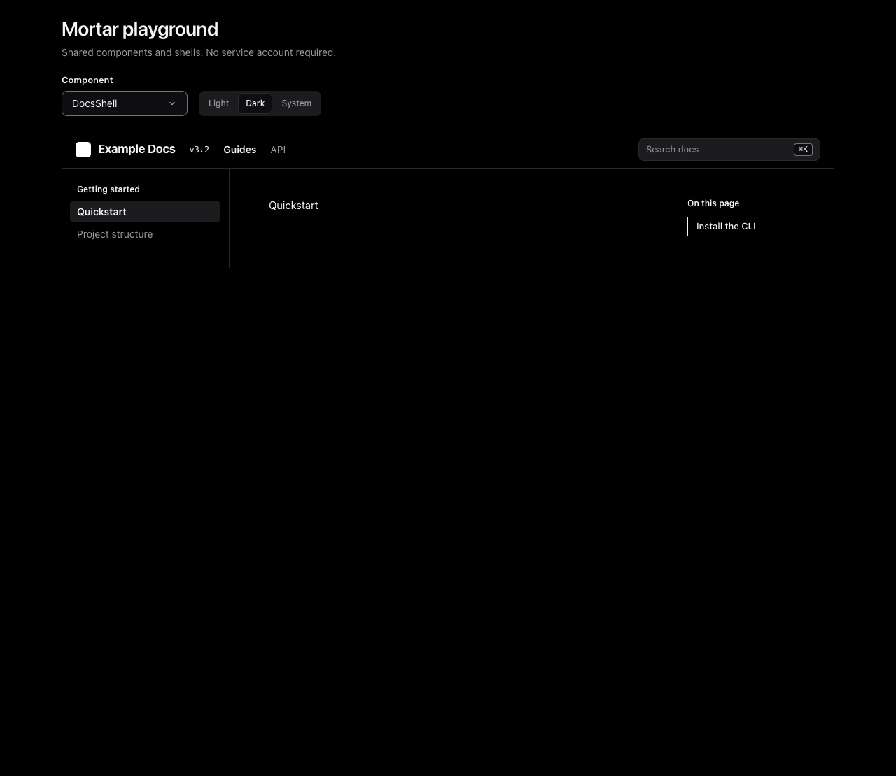

## DocsShell-dark-at-390px

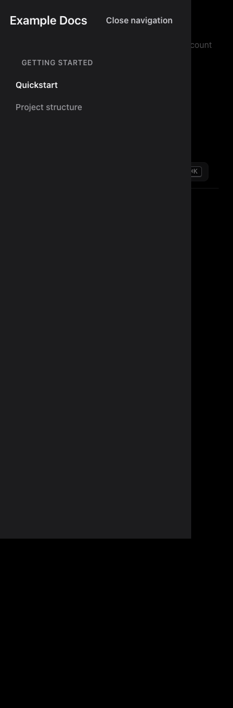

## DocsShell-light-at-1280px

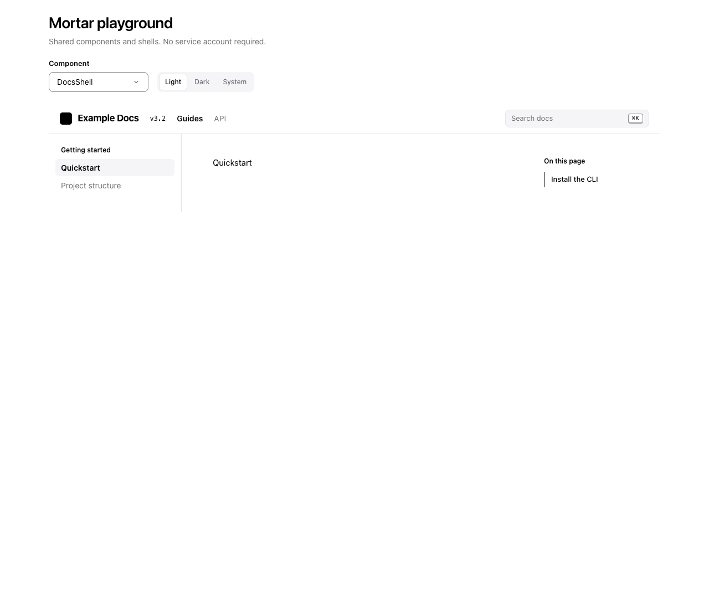

## DocsShell-light-at-390px

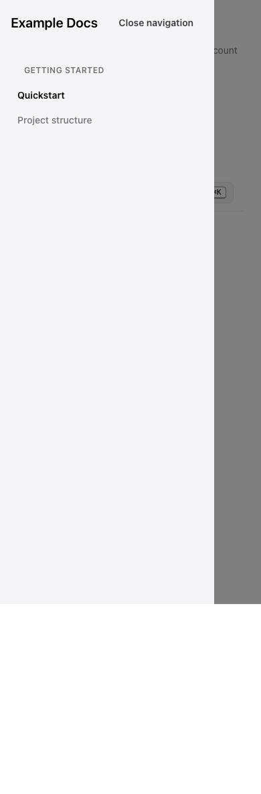

## PlanComparison-dark-at-1280px

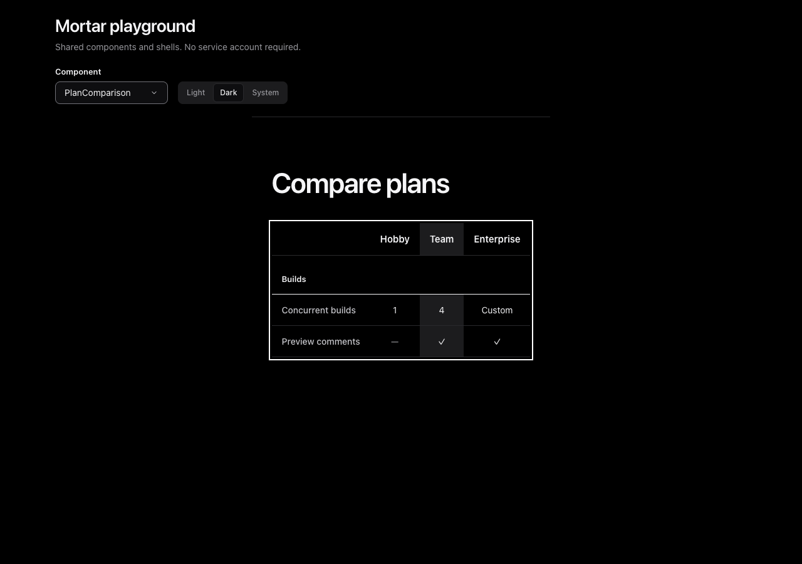

## PlanComparison-dark-at-390px

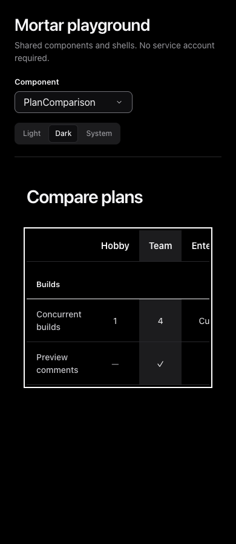

## PlanComparison-light-at-1280px

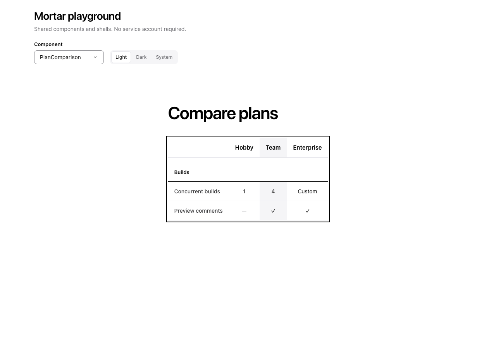

## PlanComparison-light-at-390px

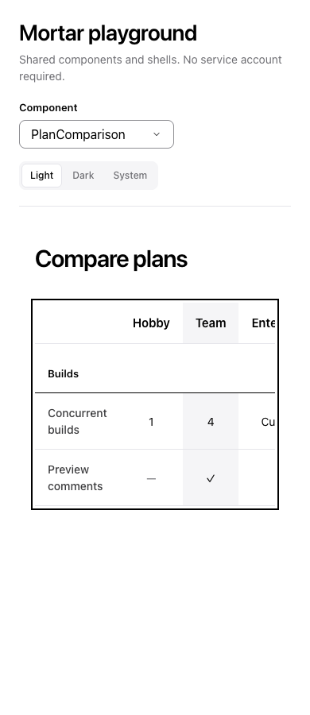
