# Visual baseline proposals

Accepted regression references for `npm run test:visual`. Baselines are Linux only (Ubuntu 24.04, as in CI). A PR that changes them proposes new references, which apply only once the maintainer accepts that PR. Required CI compares images and never updates them; see [TESTING.md](../../TESTING.md#visual-baselines).

The first Linux images were rendered on Ubuntu 24.04 by [candidate run 38596920983](https://github.com/tonycodes/mortar/actions/runs/38596920983). They use the committed production playground and default neutral brand.

The nine components and two templates added later (Button, Tabs, TabNav, DataTable, Calendar, Pricing, Hero, ProductOverview, ShoppingCart, `saas-landing`, `cart-page`) were rendered for Linux by [candidate run 39311215642](https://github.com/tonycodes/mortar/actions/runs/39311215642).

The twelve email images (`email-<template>-375` and `email-<template>-600`, [#91](https://github.com/tonycodes/mortar/issues/91)) render each template from `@tonycodes-ui/mortar/email` as a mail client shows it, light only. The images were rendered by [candidate run 42249173108](https://github.com/tonycodes/mortar/actions/runs/42249173108).

### AppShell-dark-1280

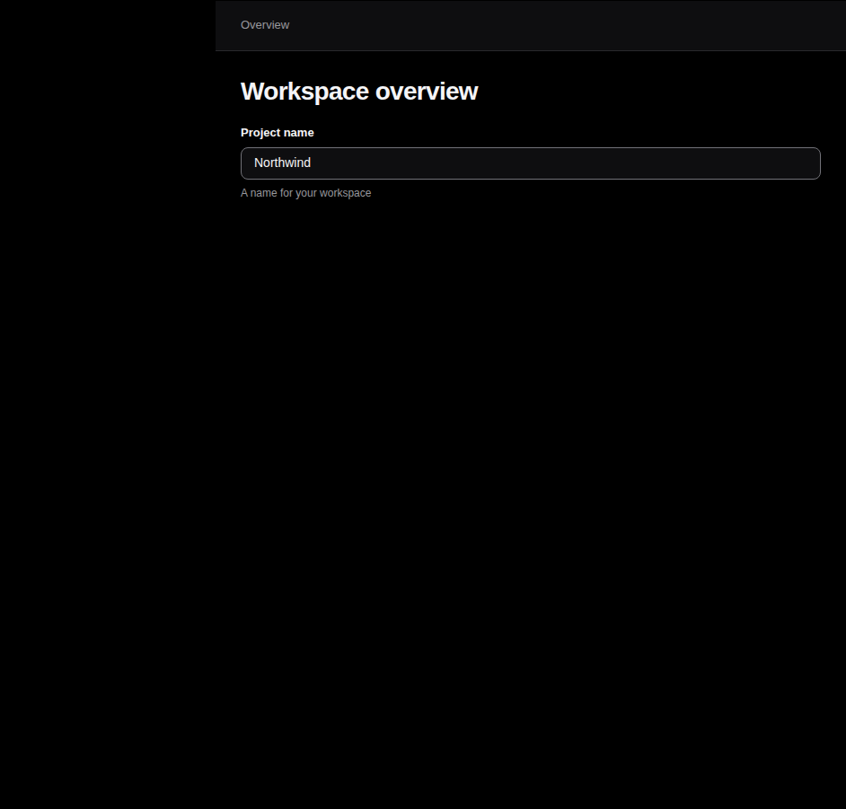

### AppShell-dark-390

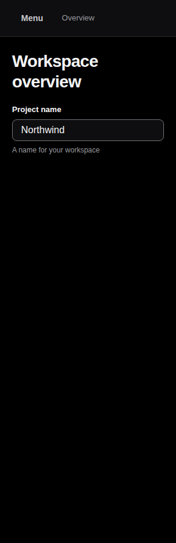

### AppShell-light-1280

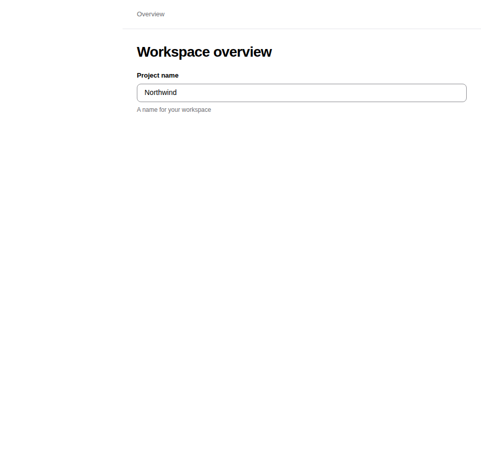

### AppShell-light-390

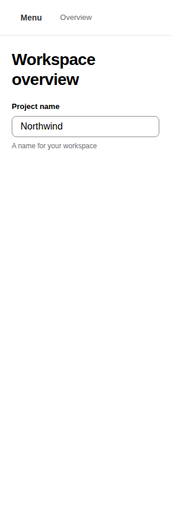

### ConfirmDialog-dark-1280

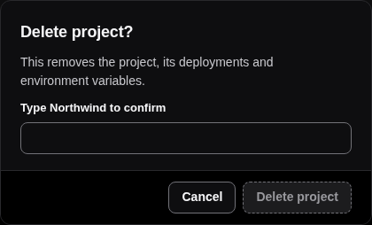

### ConfirmDialog-dark-390

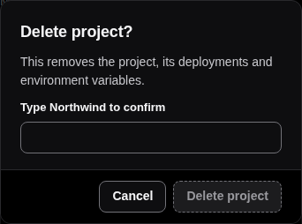

### ConfirmDialog-light-1280

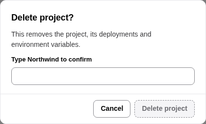

### ConfirmDialog-light-390

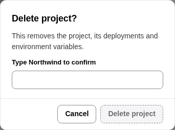

### DocsShell-dark-1280

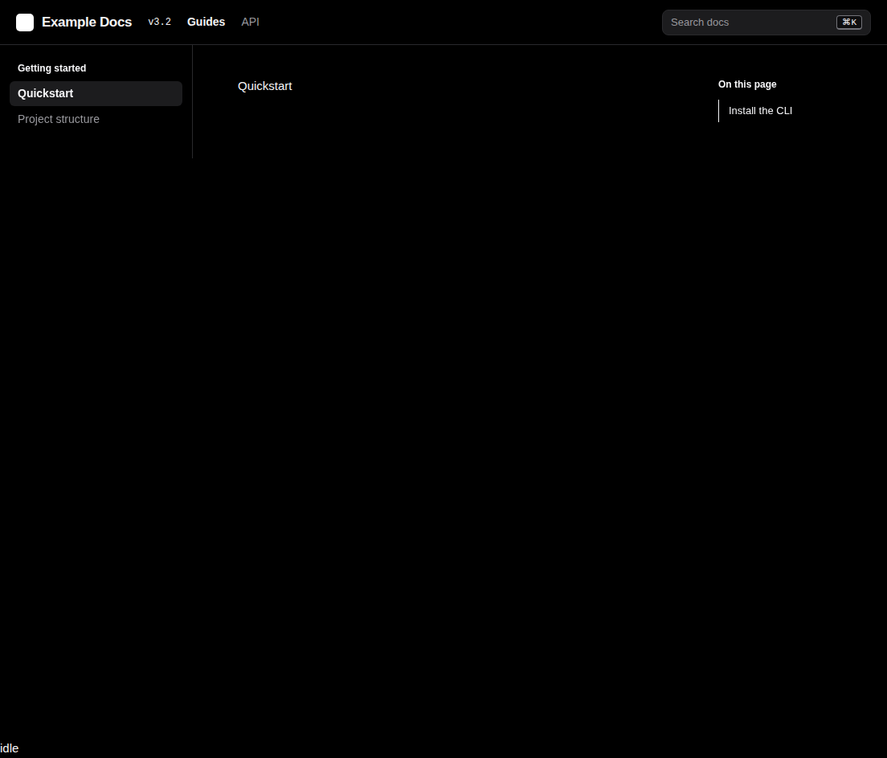

### DocsShell-dark-390

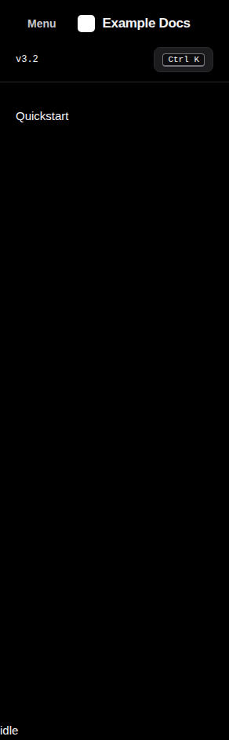

### DocsShell-light-1280

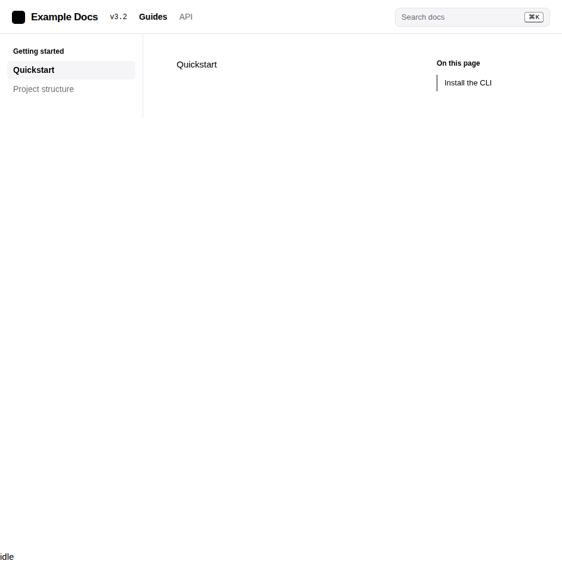

### DocsShell-light-390

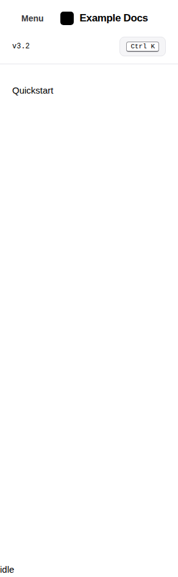

### PlanComparison-dark-1280

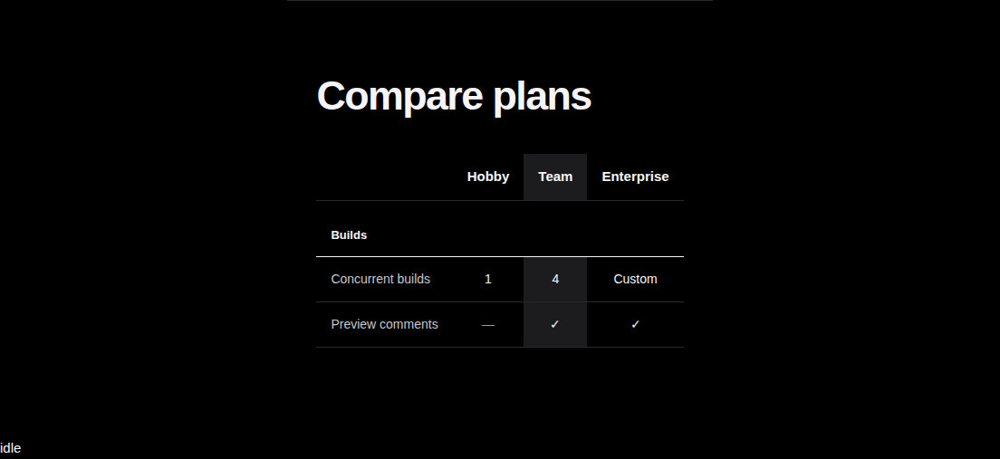

### PlanComparison-dark-390

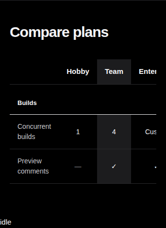

### PlanComparison-light-1280

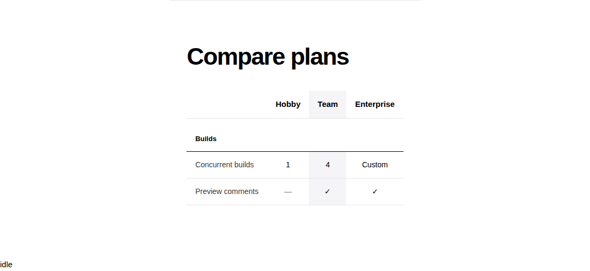

### PlanComparison-light-390

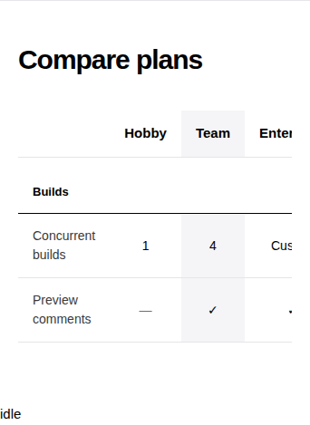
